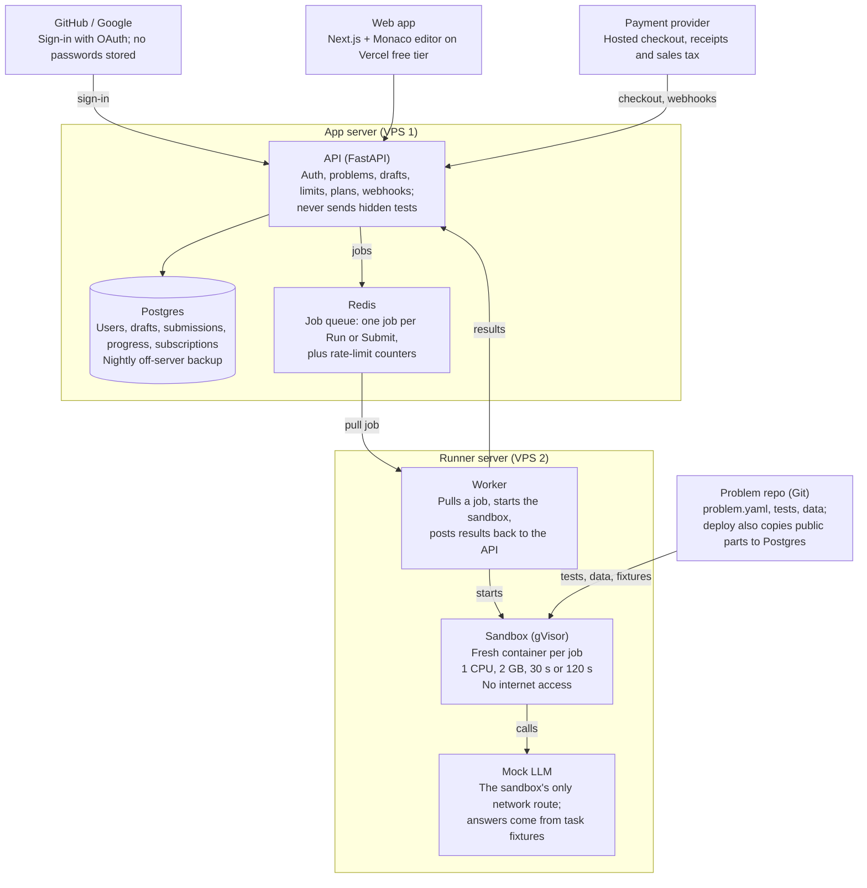
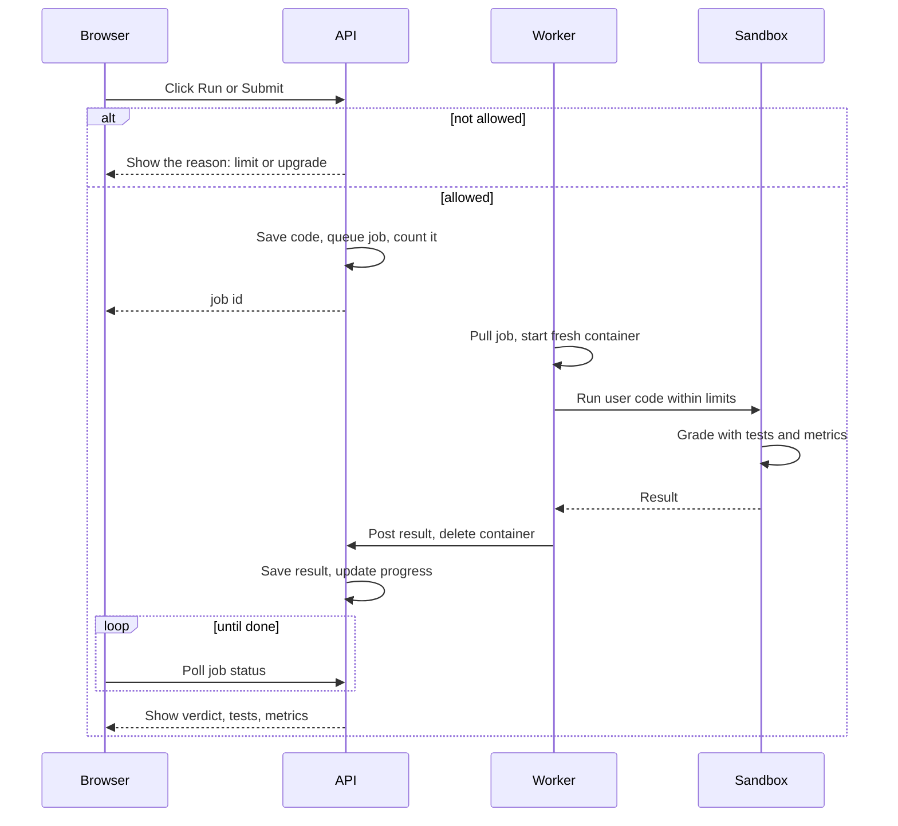
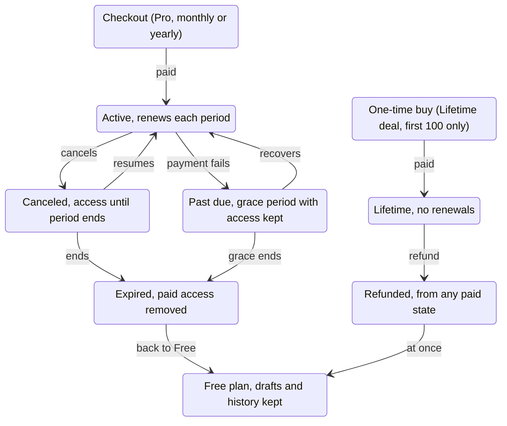

> Imported on 2026-10-22 from the planning doc written under the working name "Onsite",
> which became zagoat. [CLAUDE.md](../CLAUDE.md) is the source of truth where the two differ:
> it adds learning paths (a `paths` table and `GET /paths`), and the code has no
> `users.deleted_at` because account deletion removes the row outright.

# Onsite — Architecture and Business Logic (MVP)

2026-10-21

This spec describes how the Onsite MVP is built and how its plans, limits and billing work. It follows the Recommended start column of the v2 decisions doc; if a decision changes there, update the matching section here. Sections 1–6 cover architecture, 7–10 cover business logic, and 11 lists open questions.

## 1. System overview

User code runs on a separate server, away from the database. Arrows show who calls whom.



The web app calls one API, the only part with database credentials; user code runs only inside the sandbox on the second server. Monitoring and backups are left out of the picture; section 2 lists them.

## 2. Components

The MVP runs on two small servers plus hosted services, within the ~$50/month budget cap. Only API code touches the database, and only the runner server touches user code.

| Component | What it does | Runs on | Built with | Cost |
| --- | --- | --- | --- | --- |
| Web app | Problem pages, Monaco editor, results, history, account and billing screens; never receives hidden tests | Vercel | Next.js, Tailwind, Monaco | Free tier |
| API | Sign-in, problems, drafts, limits, plans, job creation, results, webhooks | App server (VPS 1) | FastAPI | Part of VPS 1 |
| Database | Users, drafts, submissions, progress, subscriptions | App server, or a free managed tier | Postgres | Part of VPS 1 |
| Job queue | Holds Run and Submit jobs; stores rate-limit counters | App server, reachable only from the API and the runner's IP | Redis | Part of VPS 1 |
| Worker | Pulls a job, starts a sandbox, collects the result and posts it to the API | Runner server (VPS 2) | Python | Part of VPS 2 |
| Sandbox | Runs user code and the grader in a fresh container per job | Runner server | Docker with gVisor (runsc) | Part of VPS 2 |
| Mock LLM | Answers chat and embedding calls from task fixtures; the sandbox's only network route | Runner server, on an internal Docker network | Small FastAPI app | Part of VPS 2 |
| Problem repo | One folder per task; CI checks each task, then deploys public parts to the database and hidden parts to the runner | Private GitHub repo + GitHub Actions | Git, YAML | Free tier |
| Payments | Hosted checkout, receipts, sales tax, customer portal; sends webhooks | Paddle, Lemon Squeezy or Stripe | Provider SDK | Fee per sale |
| Sign-in | OAuth login | GitHub and Google | OAuth 2.0 | Free |
| Monitoring | Errors and product analytics | Sentry; PostHog or Plausible | Provider SDKs | Free tiers |
| Backups | Nightly database dump, stored off the server | Object storage | pg_dump + cron | Storage only |

Splitting the servers limits the damage of a sandbox escape: the runner holds no database or payment credentials.

## 3. Submission flow

Every job is checked before it runs, then graded in a fresh sandbox. Run grades against sample tests; Submit adds hidden tests and metric thresholds.



“Allowed?” checks that the user is signed in, can open the problem, is under their limits and has no other job running. The browser polls the job until the API has saved the result; a system error refunds the Submit.

## 4. Sandbox and grading

Every Run and Submit gets a fresh gVisor container on the runner server, deleted when the job ends. Run checks the visible sample tests; Submit adds hidden tests and metric thresholds and decides the verdict.

### Limits

Values marked "proposed" are starting points to tune after launch.

| Setting | Run | Submit |
| --- | --- | --- |
| CPU | 1 core | 1 core |
| Memory | 2 GB | 2 GB |
| Time limit | 30 s | 120 s |
| Network | Mock LLM only | Mock LLM only |
| Disk | Read-only image; 200 MB writable /tmp (proposed) | Same |
| Processes | 64 max (proposed) | 64 max (proposed) |
| Tests | Sample tests from the statement | Hidden tests + metric thresholds |
| Output shown | stdout and stderr, first 64 KB (proposed) | Test names, author-written messages and metrics only |

### Container hardening

- gVisor runtime (runsc), so user code talks to a user-space kernel instead of the host's
- Non-root user, all Linux capabilities dropped, no-new-privileges set
- An internal Docker network whose only other member is the mock LLM
- Task image pinned by digest; task data mounted read-only
- No secrets inside: no database, Redis or payment credentials

### Task package

Each task is one folder in the problem repo. CI rejects a task unless its reference solution passes its own grader within the Submit limits.

```yaml
id: rag-chunking-01
title: Fix the chunking in a RAG pipeline
category: rag            # rag | training | evals | serving
difficulty: medium
est_minutes: 45
access: free             # free | paid
image: onsite-py311-ml   # pinned by digest at deploy
files:
  statement: statement.md
  starter: starter/
  data: data/            # synthetic or licensed only
  hints: hints.md
  walkthrough: walkthrough.md   # paid users only
  reference: reference/         # shown after first Submit
grader:
  sample_tests: tests/sample/   # used by Run
  hidden_tests: tests/hidden/   # used by Submit, never leaves the runner
  metrics:
    - name: recall_at_5
      threshold: 0.80
mock_llm: fixtures/llm.jsonl
```

### Mock LLM

Tasks call the model with an OpenAI-compatible request shape, since most LLM libraries can point at one, so solutions look like production code. A prompt that matches the task's fixtures gets its recorded answer; anything else gets a fixed fallback. The mock also returns precomputed embeddings for the task's texts and logs every call, so a grader can check, for example, that retrieved context reached the prompt.

### Verdicts

| Verdict | Meaning | Counts toward the daily limit |
| --- | --- | --- |
| Passed | All hidden tests pass and every metric meets its threshold | Yes |
| Failed | At least one test or metric misses | Yes |
| Error | The code raised an exception or failed to import | Yes |
| Time limit | Hit the 30 s or 120 s limit | Yes |
| Memory limit | Went over 2 GB | Yes |
| System error | Our fault: worker crash, image problem, or 5 minutes stuck in the queue | No, refunded |

### Known limits at MVP

Grading runs in the same process as user code, so a determined user could fake a pass or read hidden tests. At MVP that only cheats the user, since there are no leaderboards or certificates. Grading must move to a separate process before any ranking or hiring feature.

## 5. Data model

Eleven Postgres tables cover the MVP. Plan definitions and limits live in code as config, so changing a limit never needs a migration.

| Table | Key fields | Notes |
| --- | --- | --- |
| users | id, email, name, avatar_url, code_opt_in, created_at, deleted_at | Email comes from GitHub or Google; code_opt_in defaults to false |
| oauth_accounts | user_id, provider, provider_user_id | One user can link both GitHub and Google |
| sessions | id, user_id, expires_at | Server-side sessions in an HTTP-only cookie |
| problems | id (slug), title, category, difficulty, est_minutes, access, version, published | Synced from the problem repo; public fields only |
| drafts | user_id, problem_id, files (JSON), updated_at | One per user per problem; autosaved |
| submissions | id, user_id, problem_id, problem_version, kind (run or submit), files (JSON), status, verdict, tests_passed, tests_total, metrics (JSON), duration_ms, counted, created_at | status goes queued → running → done; counted records whether it used quota |
| progress | user_id, problem_id, state, hints_revealed, first_submit_at, solved_at, timer_seconds | One row per user per problem; drives unlocks and the history page |
| subscriptions | id, user_id, provider, provider_ref, plan (pro_monthly, pro_yearly or lifetime), status, current_period_end, created_at | Changed only by verified webhooks |
| webhook_events | provider_event_id (unique), type, received_at, processed_at | Stops a webhook from being applied twice |
| usage_daily | user_id, day (UTC), submits | Daily Submit count; hourly Run limits live in Redis |
| waitlist | email, source, consent, created_at | Landing page signups, before accounts exist |

## 6. API endpoints

The browser talks to one JSON API. Every route checks the session, the plan and the limits on the server; the browser only hides buttons.

| Route | Who can call it | What it does |
| --- | --- | --- |
| GET /auth/{github or google}/start and /callback | Anyone | OAuth sign-in; creates the user on first login |
| POST /auth/logout | Signed in | Ends the session |
| GET /me | Signed in | Profile, plan, today's usage and reset time |
| DELETE /me | Signed in | Deletes the account and its code, drafts and history |
| GET /problems | Anyone | List with category, difficulty, access and the user's progress |
| GET /problems/{id} | Anyone | Statement; starter code needs access to the problem |
| POST /problems/{id}/hints/{n} | Users with access | Reveals the next hint and records it |
| GET /problems/{id}/walkthrough | Lifetime and Pro | Full written walkthrough |
| GET /problems/{id}/reference | Users who submitted once | Reference solution |
| PUT /problems/{id}/draft | Users with access | Autosave, debounced in the browser |
| POST /problems/{id}/runs | Users with access | Checks limits, queues a Run, returns a job id |
| POST /problems/{id}/submissions | Users with access | Checks the daily limit, queues a Submit, returns a job id |
| GET /jobs/{id} | Job owner | Status and result; the browser polls every 1–2 s |
| GET /problems/{id}/submissions | Owner | Submission history for one problem |
| POST /billing/checkout | Signed in | Creates a hosted checkout for Pro or Lifetime |
| GET /billing/portal | Paying users | Link to the provider's portal to cancel or update a card |
| POST /webhooks/payments | Payment provider | Signature-checked, idempotent billing updates |
| POST /waitlist | Anyone | Landing page signup; rate-limited per IP |
| POST /internal/jobs/{id}/result | Worker only | Result upload; shared secret plus IP allowlist |

## 7. Plans and entitlements

Free and Lifetime (first 100 buyers) exist at launch; monthly Pro opens once the library reaches about 20 problems. Lifetime and Pro unlock the same things and differ only in how they are paid.

| Capability | Visitor | Free | Lifetime | Pro |
| --- | --- | --- | --- | --- |
| Browse problems and read statements | Yes | Yes | Yes | Yes |
| Editor, Run and Submit on free problems (~3 at launch) | Sign in first | Yes | Yes | Yes |
| Editor, Run and Submit on paid problems | No | No | Yes | Yes |
| Hints | No | On free problems | Yes | Yes |
| Walkthroughs | No | No | Yes | Yes |
| Reference solution | No | After first Submit | After first Submit | After first Submit |
| Code history | No | Yes | Yes | Yes |
| Submits per day | — | ~10 | Fair-use cap | Fair-use cap |
| AI features (after launch) | No | No | Yes, capped | Yes, capped |
| Price | — | $0 | One-time; price to be set | ~$15/month or ~$99/year |

Paid statements stay public so search engines and visitors can see what they would unlock.

### Access rule

A user has paid access when they hold an unrefunded lifetime purchase, or a Pro subscription that is active, past due within its grace period, or canceled but not yet at its period end. Everyone else is on Free. The API works this out from the subscriptions table on each request, so no separate flag can drift out of date.

## 8. Limits and quotas

Limits protect the ~$50 budget and the runner's few job slots. The API checks them before a job is queued, never after it runs.

| Limit | Free | Lifetime and Pro | Enforced in | What the user sees |
| --- | --- | --- | --- | --- |
| Submits per day | 10 | 100 fair use (proposed) | API, usage_daily table | Remaining count and reset time; Free users also see an upgrade link |
| Runs per hour | 30 (proposed) | 120 (proposed) | API, Redis counter | "Try again in N minutes" |
| Jobs in flight | 1 | 1 | API, open-job check | Run and Submit disabled until the current job finishes |
| Draft size | 1 MB (proposed) | 1 MB (proposed) | API | Save error showing the size |
| Time in queue | 5 min max | 5 min max | Worker drops older jobs | System error, not counted |
| Sign-in and waitlist attempts | 5 per IP per hour (proposed) | — | API, Redis counter | "Too many attempts" |

- Days reset at 00:00 UTC; the UI shows the reset in the user's local time.
- A Submit counts when it is queued and is refunded if it ends in a system error.
- Runs never count toward the daily Submit limit.
- How many jobs run at once depends on the runner's memory: at 2 GB a job, an 8 GB server runs about 3, leaving room for the worker and mock LLM.
- If abuse appears, such as bursts of new accounts or CPU-heavy loops, add a captcha at sign-up and lower the Free limits.

## 9. Billing lifecycle

Canceling keeps access until the period ends; a refund ends it at once. Active, Canceled, Past due and Lifetime have paid access.



Billing state changes only through verified webhooks from the payment provider; the browser never grants access. Event names below are generic because Paddle, Lemon Squeezy and Stripe each name them differently.

| Provider event | Our update | Access |
| --- | --- | --- |
| Subscription checkout completed | Create the subscription as active; store the period end | Paid from now |
| Lifetime purchase completed | Create a lifetime record; stop selling at 100 | Paid, no end date |
| Renewal paid | Move the period end forward; status active | Continues |
| Payment failed | Status past due | Kept for a 7-day grace period (proposed) |
| Subscription canceled | Status canceled | Kept until the period end |
| Subscription resumed | Status active | Continues |
| Subscription ended | Status expired | Back to Free |
| Refund or chargeback | Status refunded | Removed at once |

### Handling rules

- Verify the signature, then record the event id; a repeated id is acknowledged and skipped.
- On every event, fetch the subscription's current state from the provider and save that, so events arriving out of order can't leave a wrong status.
- Reply 200 quickly; if processing fails, the provider retries.
- A nightly job compares paid users with the provider and fixes any drift.

## 10. Progress, unlock and account rules

Only a passing Submit marks a problem solved, and once solved it stays solved. These rules also decide what unlocks and what survives a downgrade or deletion.

| Rule | Behavior |
| --- | --- |
| Progress states | Not started → In progress (first draft save or Run) → Attempted (first Submit) → Solved (a Submit passes) |
| Solved is permanent | A later failing Submit or a new problem version never removes Solved |
| Reference solution | Unlocks after the first Submit with any verdict except system error |
| Hints | Revealed one at a time; reveals are recorded but carry no penalty at MVP |
| Walkthroughs | Paid users can open them any time; the page warns that it shows the solution |
| Timer mode | Optional toggle; records time to Submit and never changes the verdict |
| Problem versions | Each submission stores the version it ran against, so history shows old results as they were |
| Downgrade to Free | Drafts, history and Solved states stay; paid problems become read-only |
| Account deletion | Self-service; removes the user, drafts, submissions and progress at once; backups age out within 30 days (proposed); billing records stay with the payment provider |
| Use of user code | Used only for grading unless the user opts in |

## 11. Open questions

This spec assumes answers to these, but they are still open in the decisions doc.

- [ ] Payment provider: it sets the exact webhook names and the customer portal (section 9)
- [ ] Lifetime price, and whether a sale that lands after #100 is honored (proposed: honor it)
- [ ] Fair-use caps for Lifetime and Pro (proposed: 100 Submits a day, 120 Runs an hour)
- [ ] Runner server size, which sets how many jobs run at once
- [ ] Grace period for failed payments (proposed: 7 days)
- [ ] Backup retention after account deletion (proposed: 30 days)
- [ ] Whether some tasks need a capped real model before the mock LLM is replaced
